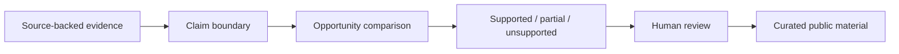

# Career Intelligence

Career Intelligence is a synthetic case study about evidence-first career reasoning.

It starts with a different question from most job-search tools: what is true about this person, what supports it, what remains uncertain, and what is safe to say for this opportunity?

This public repository follows Andy Barks, a completely fictional person moving through library services, education, and curriculum design. It demonstrates provenance, transferable-skill reasoning, capability fit versus environment fit, uncertainty, and claim safety without publishing a reusable career engine.

## Explore the case study

1. Read [Andy Barks: evidence to role comparison](examples/andy-barks/case-study.md).
2. Inspect the small [synthetic evidence cards](examples/andy-barks/evidence.json).
3. Run the deliberately incomplete [supported / partial / unsupported comparison](examples/toy_comparison.py).
4. Review the [architecture boundaries](docs/architecture.md), [evidence and provenance](docs/evidence-and-provenance.md), and [person-model safety](docs/person-model-safety.md).

```bash
python3 examples/toy_comparison.py
python3 -m unittest examples/tests/test_toy_comparison.py
```

## Core ideas

- evidence before language
- facts and wording remain separate
- transferable skills can cross job-title boundaries
- capability fit and environment fit are different questions
- reflection may guide review but is not credential evidence
- gaps and conflicting evidence remain visible
- human review is required before public claims

## Public architecture



The toy comparison uses no score and does not select, rank, rewrite, or generate career materials. Its labels describe the fictional fixture only.

## Intentionally withheld

The public repository does not contain a complete person model, production schema, reusable templates, scoring or ranking, weights, default configuration, evidence-selection logic, safety policies, generation pipeline, resume generator, positioning generator, interview-prep generator, acquisition workflow, prompts, or private career data.

## Status

The private research direction continues beyond this case study. Publicly, the project is intentionally limited to an inspectable synthetic example and the product reasoning behind it.
